# SEAR

**Safe Evolution of Agentic Robots: Verifiable Safety Invariants for Self-Improving Physical Agents**

<p align="center">
  
</p>

A robot may be safe in generation *k* and unsafe after an apparently beneficial update to its policy, memory, evaluator, or tools. SEAR is a framework for admitting autonomous updates only with independently checkable evidence, so that task capability can improve across generations while physical safety violations and safety-margin degradation stay bounded.

**Key results (simulation, 5 seeds each):**
- SPE achieves **FAR(dep) = 0.00** and **zero deployment violations** at every seed on both benchmark tasks
- Neither verification alone (B2) nor runtime assurance alone (B1/B3) achieves this — their combination is necessary
- Rollback eliminates dense violation accumulation on nailing (32→0 violations, 2 reverts) but cannot recover sparse OOD margin erosion on peg insertion
- Verification budget phase transition at *n*_sim ≈ 60: below this point the verifier is over-conservative; above it, safety and capability are both maintained

## Concepts

| Formalism | Code |
|---|---|
| system state z_k = (θ, m, d, τ, r, e, P) | `sear.core.SystemState` |
| update operator z_{k+1} = U(z_k, Δ_k) | `sear.core.apply_update`, `CandidateArtifact` |
| immutable safety contract 𝔠 (WP1) | `sear.contracts` — YAML + HMAC signature, `SafetyOracle` |
| Admit(z_k, z_{k+1}) ⇒ Evidence ⊨ 𝔠 (WP2) | `sear.verification` — 5-tier pipeline → `Evidence` |
| runtime assurance, CBF-QP, fallback (WP3) | `sear.runtime` — `RuntimeAssurance`, `domain_from_contract` |
| evidence lineage, retrieval, rollback (WP4) | `sear.lineage` — hash-chained ledger |
| multi-generation protocol and baselines | `sear.evolution` — `EvolutionLoop`, B0–B3, B1R, SPE |
| figures, videos, aggregate tables | `sear.viz` — `plots`, `render`, `aggregate` |

Every verdict is `PASS`, `FAIL`, or `UNKNOWN`, and `UNKNOWN` is never treated as safe.
All evidence is tagged as **deterministic** (under stated model assumptions), **probabilistic** (exact Clopper–Pearson bounds), or **empirical**.

## Layout

```
src/sear/
  core/          versioned system state, update operator, content hashing, trajectories
  contracts/     constraint language (physical / temporal / operational), signing, oracle
  sim/           planar contact-rich simulators: nailing (ContactToolEnv) and peg insertion (PegEnv)
  policies/      parametric controllers (θ_k): ApproachPress (nailing), PegInsert (peg)
  benchmark/     frozen, content-pinned suites: in-dist / held-out / OOD / adversarial
  runtime/       latency-aware CBF-QP safety filter, runtime monitor, safe stop
  verification/  5 tiers: integrity, permissions, replay regression, randomised sim,
                 barrier certificate + statistical bound → admit / restrict / reject
  lineage/       append-only hash-chained ledger, safety-regression retrieval, rollback
  metrics/       episode & suite metrics, Clopper–Pearson / Wilson / Poisson bounds
  evolution/     task evaluator, proposers (greedy, Safe-RL, adversarial, external/LLM), loop
  viz/           generation-curve plots, summary bars, trajectory MP4 videos, aggregate tables
  robots/        hardware interface stub for real-manipulator experiments
  cli.py         `sear` command
configs/
  contracts/     signed safety contracts (nailing surrogate, peg insertion)
  experiments/   study configurations
runs/            experiment outputs (created at runtime, gitignored)
tests/
```

## Quick start

```bash
uv venv --python 3.11 .venv && uv pip install --python .venv/bin/python -e ".[dev]"
source .venv/bin/activate

pytest                                                        # 64 tests, all pass
sear run configs/experiments/smoke.yaml                       # ~20 s sanity run
sear run configs/experiments/nailing_default.yaml             # nailing, all methods, seed 0
sear run configs/experiments/peg_insertion.yaml               # peg insertion, all methods, seed 0
sear run configs/experiments/rollback_demo.yaml               # B1 vs B1R rollback ablation
sear run configs/experiments/nsim_ablation_60.yaml            # verification budget ablation
sear report runs/nailing_default                              # ASCII comparison table
sear aggregate runs/nailing_default runs/nailing_default_s1 runs/nailing_default_s2 \
  runs/nailing_default_s3 runs/nailing_default_s4            # multi-seed mean±std
sear aggregate ... --latex --out runs/nailing_table.tex       # LaTeX table for paper
sear render runs/nailing_default --n-episodes 3               # trajectory MP4 videos
sear verify-ledger runs/nailing_default/SPE/ledger.jsonl      # audit evidence chain
```

## Methods compared

| Method | Update verification | Runtime assurance | Lineage + rollback | Agent |
|---|---|---|---|---|
| **B0** | – | – | – | task-greedy |
| **B1** | – | ✓ | – | task-greedy |
| **B1R** | – | ✓ | rollback only | task-greedy |
| **B2** | ✓ | – | – | task-greedy |
| **B3** | – | ✓ | – | Lagrangian Safe-RL |
| **SPE** | ✓ | ✓ | ✓ | task-greedy |

The adversarial proposer injects scheduled unsafe updates: evaluator tampering, tool escalation, protected-file writes, aggressive parameters, and memory poisoning.
Both attack types and schedules are configurable per experiment YAML.

## Benchmark tasks

| Task | Physics | Key constraints | Config |
|---|---|---|---|
| **Nailing** | Planar contact-rich tool use, 2D workspace | Force bound, speed limit, workspace box, tool retention | `nailing_default.yaml` |
| **Peg insertion** | 3-zone contact (free/rim/in-hole), floor stop | Lateral force, speed limit, workspace box, insertion depth | `peg_insertion.yaml` |

## Experimental results

Multi-seed aggregates (5 seeds × 20 generations, nailing; peg insertion):

```
         unsafe adm.(raw)  unsafe adm.(dep)  FAR(raw)  FAR(dep)  dep.viol  ID succ  OOD succ  ID mret
B0              43/43             43/43        1.00      1.00      65.6     1.00     1.00     -33.0
B1              43/43             15/15        1.00      1.00      40.0     1.00     0.52      0.93
B2               0/28              0/28        0.00      0.00       0.0     1.00     1.00      0.96
B3              40/40             17/17        1.00      1.00      40.0     1.00     0.53      0.93
SPE             10/40              0/15        0.23      0.00       0.0     1.00     0.87      0.98   ← nailing
SPE              0/10              0/15        0.00      0.00       0.0     1.00     0.90      1.00   ← peg
```

Full tables with confidence intervals: `runs/nailing_table.tex`, `runs/peg_table.tex` (generated by `sear aggregate --latex`).

## Safety contracts

Contracts live in `configs/contracts/` and are owned by the human safety authority.
After editing, re-sign with:

```bash
export SEAR_CONTRACT_KEY=...     # never available to the improvement agent
sear sign-contract configs/contracts/nailing_surrogate.yaml
```

The committed signature uses the built-in **development key** (simulation only).
Verify an evidence ledger's hash chain:

```bash
sear verify-ledger runs/SPE/ledger.jsonl
```

## Plugging in a real agent

`sear.evolution.ExternalAgentProposer` wraps any callable (e.g., an LLM coding agent).
The callable receives permitted observations as a dict and returns `UpdateProposal` fields.
Everything it proposes passes through the same verifier, runtime assurance, and ledger.

## Status

Simulation complete (all baselines, two tasks, 5 seeds, rollback demo, n_sim ablation, 45+ MP4 trajectory videos, LaTeX tables). Real-robot integration (`sear.robots.RobotInterface`) is the next milestone.
